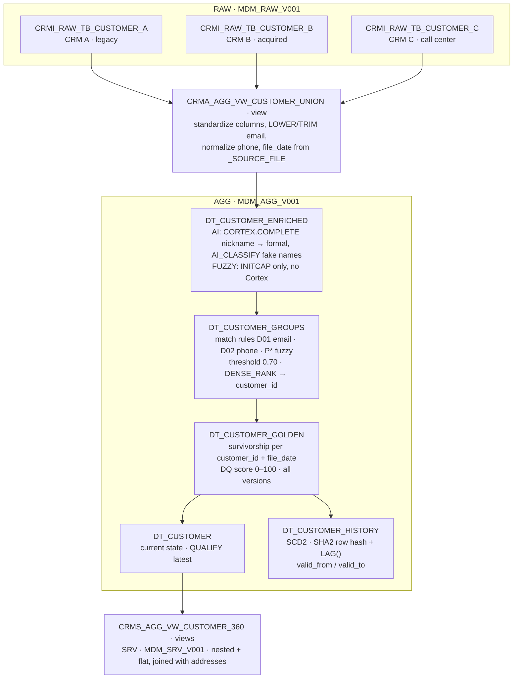

# MDM Spec - Bulk: Snowflake native

## Marcel Däppen | Principal Solutions Engineer | Snowflake | EMEA Growth Markets

## **Executive Summary**

Through M\&A and other historical changes, organizations often end up running multiple systems in parallel (CRM, ERP, billing, support, etc.) that all store overlapping information about the same real‑world entities. The result is fragmented and conflicting master data: duplicates, inconsistent attributes, missing history, and no single, trusted view across channels and lines of business.

This showcase explains why we need Master Data Management (MDM), what we aim to deliver, and how we implement it using CRM (customer relationship data) as a concrete example. The centerpiece is a **golden customer record** per real-world customer -- including a linked primary address -- assembled from three CRM systems into a single, trusted view with transparent logic for matching, survivorship, and data quality scoring.

**Why MDM and Target Business Outcomes:** See [MDM_SPEC_Shared.md](MDM_SPEC_Shared.md#why-master-data-management) for business problems, target outcomes, and key MDM concepts that apply across both pipelines.

**Scope, Key Concepts, and Glossary:** See [MDM_SPEC_Shared.md](MDM_SPEC_Shared.md#scope) for what is in/out of scope, key MDM concepts, and term definitions.

## **CRM Showcase: From Fragmented CRM Data to Golden Customer Records**

### Baseline Situation

In the showcase, we ingest 1,500 customer + address records from three CRM systems (see [MDM_SPEC_Shared.md](MDM_SPEC_Shared.md#source-systems-and-trust-hierarchy) for source definitions and trust hierarchy):

- CRM_A -- 600 customers
- CRM_B -- 400 customers
- CRM_C -- 500 customers

These are merged into **1,115 golden customer records** with 1:1 linked primary addresses, yielding a **24.4% merge rate**, a total of **272 merged customers**, and an average **DQ score of 95**, with **973 records** in the “Excellent” DQ tier.

This demonstrates that even relatively “clean” CRM landscapes can hide a significant amount of duplication and inconsistency.

**End-to-End MDM Process:** See [MDM_SPEC_Shared.md](MDM_SPEC_Shared.md#end-to-end-mdm-process) for the four-step pipeline (Union & harmonize -> Enrich & screen -> Group -> Survive & score) used by both Bulk and NRT pipelines. The Bulk pipeline executes this via Snowflake Dynamic Tables; the NRT pipeline executes it in Python within SPCS containers.

## **How the Golden Customer Record Is Built**

This section describes how we decide which values end up in the golden customer record and why.

### Business Rules Reference

All matching, survivorship, and DQ scoring rules are defined in [MDM_SPEC_Shared.md](MDM_SPEC_Shared.md). This section covers only the Bulk-specific implementation.

**Matching and grouping:** Entity resolution uses the shared matching rule catalog. Bulk implementation: SQL CTEs with `DENSE_RANK()` for cluster assignment in `VW_CUSTOMER_GROUPS`. Cortex AI provides `canonical_first_name` (nickname normalization) and `is_fake_name` (fake detection) upstream in `DT_CUSTOMER_ENRICHED`.

> See [MDM_SPEC_Shared.md: Matching Rule Catalog](MDM_SPEC_Shared.md#matching-rule-catalog)

**Survivorship:** Bulk implementation uses `FIRST_VALUE()` with `PARTITION BY customer_id ORDER BY completeness_rank, trust_level, file_date DESC` in `DT_CUSTOMER_GOLDEN`.

> See [MDM_SPEC_Shared.md: Survivorship Rules](MDM_SPEC_Shared.md#survivorship-rules)

**DQ scoring:** Bulk applies all shared DQ rules plus AI-based rules (DQ-AI01 fake name detection via Cortex `AI_CLASSIFY`). In the CRM showcase, 973 of 1,115 golden records land in the "Excellent" tier.

> See [MDM_SPEC_Shared.md: DQ Rule Catalog](MDM_SPEC_Shared.md#dq-rule-catalog) and [Intentional Differences](MDM_SPEC_Shared.md#intentional-differences-between-pipelines)

**History and Lineage:** See [MDM_SPEC_Shared.md](MDM_SPEC_Shared.md#history-and-lineage) for the SCD2 history and auditability concepts shared across both pipelines.

## **The Implementation (Technical View)**

From a technical perspective, the CRM MDM showcase is implemented entirely with native Snowflake capabilities.

### Dataflow

At a high level, the dataflow is RAW tables → union view → enrichment → match + group → survivorship → current and SCD2 history Dynamic Tables → Customer 360 serving views. Steps from enrichment onward run as two parallel pipelines: **AI** (Cortex enrichment) and **FUZZY** (rule-based only), so both approaches can be compared on the same data.

All Dynamic Tables use `TARGET_LAG = {{dt_lag}}` from the DCM templating config (1 hour by default, 24 hours in DEV). The table and view names above omit the `CRMA_AGG_` prefix and the `_AI` / `_FUZZY` suffix of the two parallel pipelines; addresses follow the same shape (`*_ADDRESSES_*`).

Key components:

| Layer | Object | Purpose |
|---|---|---|
| RAW | `CRMI_RAW_TB_CUSTOMER_A/B/C` | Append-only landing tables, one per CRM; loaded by a directory-table stream + serverless COPY task per stage |
| Union | `CRMA_AGG_VW_CUSTOMER_UNION` | Standardized columns, harmonized email/phone formats, `file_date` from `_SOURCE_FILE` |
| Enrichment | `CRMA_AGG_DT_CUSTOMER_ENRICHED_AI` / `_FUZZY` | Canonical first name (AI: `CORTEX.COMPLETE`; FUZZY: `INITCAP`), fake-name detection (AI only: `AI_CLASSIFY`) |
| Matching | `CRMA_AGG_DT_CUSTOMER_GROUPS_AI` / `_FUZZY` | Deterministic + probabilistic rules (email, phone, Jaro-Winkler, SOUNDEX); cluster assignment via `DENSE_RANK()` |
| Survivorship | `CRMA_AGG_DT_CUSTOMER_GOLDEN_AI` / `_FUZZY` | Attribute-level survivorship and weighted DQ scoring, one version per `file_date` |
| Golden | `CRMA_AGG_DT_CUSTOMER_AI` / `_FUZZY` | Current golden customer records (latest only) |
| History | `CRMA_AGG_DT_CUSTOMER_HISTORY_AI` / `_FUZZY` | SCD Type 2 via SHA2 row hash; `VALID_FROM` / `VALID_TO` |
| Serving | `CRMS_AGG_VW_CUSTOMER_360_*` | Consumer-ready Customer 360 views (nested and flat) |

The result is a repeatable, explainable MDM pipeline implemented with SQL, Dynamic Tables, and Cortex AI functions, without requiring a separate MDM application.

## Summary

From a business point of view, MDM is not an IT project; it is a strategic capability to:

- Establish one trusted customer across systems.  
- Improve customer experience and sales effectiveness.  
- Reduce operational and regulatory risk.  
- Unlock AI‑driven and analytics‑driven value from CRM and beyond.

The CRM showcase on Snowflake proves that we can deliver all core MDM capabilities — entity resolution, survivorship, golden customer records, data quality scoring, and full history — using native platform features, with concrete, explainable logic for how each golden customer record is constructed and governed over time.